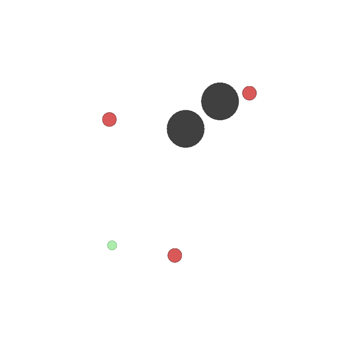

[](https://badge.fury.io/py/mpe2)
[](https://badge.fury.io/py/mpe2)
[](https://pre-commit.com/)
[](https://github.com/psf/black)
[](https://github.com/Farama-Foundation/MPE2/blob/main/LICENSE)

<p align="center">
    <a href="https://mpe2.farama.org/" target = "_blank">
    
</a>

<p align="center">
  
</p>

Multi Particle Environments 2 (MPE2) are a set of communication-oriented environments where particle agents can (sometimes) move, communicate, see each other, push each other around, and interact with fixed landmarks.

These environments are originally from [OpenAI’s MPE codebase](https://github.com/openai/multiagent-particle-envs), with several minor fixes, mostly related to making the action space discrete by default, making the rewards consistent and cleaning up the observation space of certain environments. MPE2 additionally includes 3 new environments.

## Installation

The unique dependencies for this set of environments can be installed via:

```bash
pip install mpe2
```

## Usage

With PettingZoo 1.27 or later, import `mpe2` to register its environments, then
choose the AEC or Parallel API when calling `make`.

```python
import mpe2
from pettingzoo import make

env = make("aec", "mpe/simple_push-v3", max_cycles=50)
parallel_env = make("parallel", "mpe/simple_push-v3", max_cycles=50)
```

### Basic Example

To launch a [Simple Push](/environments/simple_push/) environment with random agents:

```{code-block} python

from mpe2 import simple_push_v3

env = simple_push_v3.env(render_mode="human")
env.reset(seed=42)

for agent in env.agent_iter():
    observation, reward, termination, truncation, info = env.last()

    if termination or truncation:
        action = None
    else:
        # this is where you would insert your policy
        action = env.action_space(agent).sample()

    env.step(action)

env.close()
```

### Types of Environments

The Simple Adversary, Simple Crypto, Simple Push, Simple Tag, and Simple World Comm environments are adversarial (a "good" agent being rewarded means an "adversary" agent is punished and vice versa, though not always in a perfectly zero-sum manner). In most of these environments, there are "good" agents rendered in green and an "adversary" team rendered in red.

Collect Treasure, Simple Formation, Simple Line, Simple Reference, Simple Speaker Listener, and Simple Spread are cooperative environments. Agents must work together to achieve their goals and receive a mixture of rewards based on their own success and the success of the other agents.

### Key Concepts

* **Landmarks**: Landmarks are static circular features of the environment that cannot be controlled. In some environments, like Simple, they are destinations that affect the rewards of the agents depending on how close the agents are to them. In other environments, they can be obstacles that block the motion of the agents. These are described in more detail in the documentation for each environment.

* **Visibility** determines which other agents and landmarks an agent can observe. Simple World Comm has forests that hide agents. The environments listed under Partial Observability also support distance-based filtering.

* **Communication**: Some agents in some environments can broadcast a message as a part of its action (see action space for more details) which will be transmitted to each agent that is allowed to see that message. In Simple Crypto, this message is used to signal that Bob and Eve have reconstructed the message.

* **Color** helps identify agents and landmarks in the rendered environment. Some observations also encode color, such as the goal and landmark colors seen by the good agent in Simple Push.

* **Distances**: The landmarks and agents typically start out uniformly randomly placed from -1 to 1 on the map. This means they are typically around 1-2 units apart. This is important to keep in mind when reasoning about the scale of the rewards (which often depend on distance) and the observation space, which contains relative and absolute positions.

### Termination

The game terminates after the number of cycles specified by the `max_cycles` environment argument is executed. The default for all environments is 25 cycles, as in the original OpenAI source code.

### Observation Space

The observation space of an agent is a vector generally composed of the agent's position and velocity, other agents' relative positions and velocities, landmarks' relative positions, landmarks' and agents' types, and communications received from other agents. The exact form of this is detailed in the environments' documentation.

Observation sizes can differ by role. For example, adversaries in Simple World Comm receive the leader's communication as an additional part of their observation.

### Partial Observability

Collect Treasure, Simple Adversary, Simple Push, Simple Spread, Simple Tag, and Simple World Comm
support optional observation filters. Set `radius` to a positive finite distance to include entities
at or within that Euclidean distance. Then `num_agent_neighbors` and `num_landmark_neighbors`
can each limit the visible count to a positive integer. All three default to `None`.

For example, `simple_spread_v4.env(radius=0.75, num_agent_neighbors=2, knn_mode="masked")`
shows each agent up to two other agents within 0.75 units and every landmark in that radius.

- `"compact"` (default) packs each filtered group nearest-first and zero-pads unused slots.
  Its capacity is the configured neighbor cap, or the full group size for a radius alone.
- `"masked"` gives each entity a fixed slot and zeros hidden entries. Each agent keeps
  its full observation size as neighbors move in and out of view.

### Action Space

Note: [OpenAI's MPE](https://github.com/openai/multiagent-particle-envs) uses continuous action spaces by default.

Discrete action space (Default):

The action space is a discrete action space representing the combinations of movements and communications an agent can perform. Agents that can move can choose between the 4 cardinal directions or do nothing. Agents that can communicate choose between 2 and 10 environment-dependent communication options, which broadcast a message to all agents that can hear it.

Continuous action space (Set by continuous_actions=True):

The action space is a continuous action space representing the movements and communication an agent can perform. Agents that can move can input a velocity between 0.0 and 1.0 in each of the four cardinal directions, where opposing velocities e.g. left and right are summed together. Agents that can communicate can output a continuous value over each communication channel in the environment which they have access to.

### Rendering

Rendering displays the scene in a window that automatically grows if agents wander beyond its border. Communication is rendered at the bottom of the scene. The `render()` method also returns the pixel map of the rendered area.

### Citation

The MPE environments were originally described in the following work:

```
@article{mordatch2017emergence,
  title={Emergence of Grounded Compositional Language in Multi-Agent Populations},
  author={Mordatch, Igor and Abbeel, Pieter},
  journal={arXiv preprint arXiv:1703.04908},
  year={2017}
}
```

But were first released as a part of this work:

```
@article{lowe2017multi,
  title={Multi-Agent Actor-Critic for Mixed Cooperative-Competitive Environments},
  author={Lowe, Ryan and Wu, Yi and Tamar, Aviv and Harb, Jean and Abbeel, Pieter and Mordatch, Igor},
  journal={Neural Information Processing Systems (NIPS)},
  year={2017}
}
```

Please cite one or both of these if you use these environments in your research.
